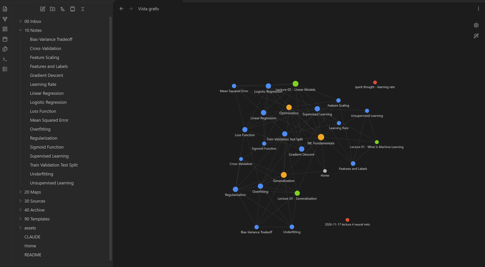
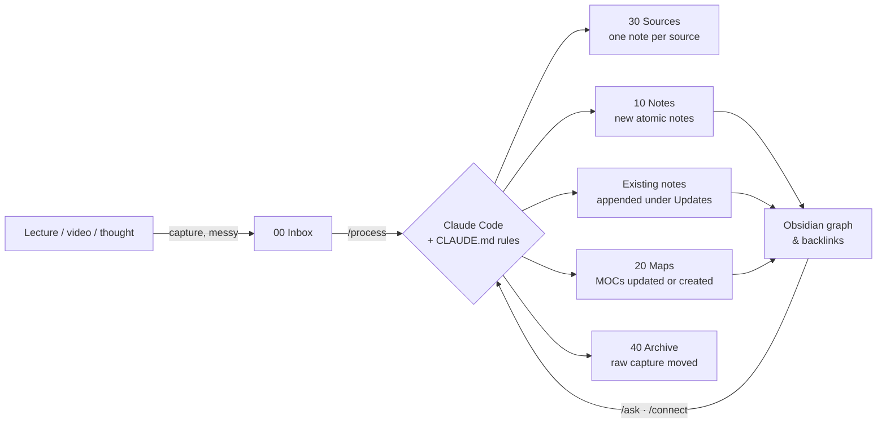

# Self-Organizing Second Brain — Obsidian × Claude Code

> Drop messy study notes into an inbox, type `/process`, and Claude Code turns them into atomic, linked notes inside your Obsidian vault.
> **No API keys, no scripts, no plugins** — just markdown files and Claude Code on your PC (desktop app or terminal).



---

## Problem

When you study something new — here, *machine learning fundamentals* — notes pile up fast: lecture bullets, video takeaways, half-formed questions.
The second-brain method says to turn them into **atomic notes** (one idea per note) and **link** them to what you already know. That's where the learning happens — and it's also the step everyone skips, because it's slow and tedious.

The result: an inbox full of raw notes, an empty graph, and knowledge that never connects.

**Goal:** keep the thinking human, automate the filing. I capture; Claude Code does the librarian work — splitting, linking, filing, archiving — while following strict rules so the vault stays *mine*.

## Tools

| Tool | Role |
|---|---|
| [Obsidian](https://obsidian.md) | The vault: markdown files, `[[wikilinks]]`, backlinks, graph view. No community plugins needed. |
| [Claude Code](https://docs.claude.com/en/docs/claude-code/overview) | Runs on the vault folder, either in the Claude desktop app (**Code** tab) or in a terminal. Reads and writes the markdown files directly. |
| `CLAUDE.md` | The vault's "constitution": structure, conventions and golden rules Claude must follow. Loaded automatically. |
| `.claude/commands/*.md` | Custom slash commands — plain-English prompt files, not code. |

### Vault structure

```
00 Inbox/        raw captures (messy on purpose)
10 Notes/        atomic notes — one concept each
20 Maps/         Maps of Content: ML Fundamentals → Optimization, Generalization
30 Sources/      one note per lecture / video / article
40 Archive/      raw captures after processing (never deleted)
90 Templates/    note templates
.claude/commands/
   process.md    /process  inbox → linked notes
   connect.md    /connect  propose missing links, ask before editing
   ask.md        /ask      answer only from the vault, with [[citations]]
CLAUDE.md        rules for Claude
Home.md          vault front page
```

### Try it yourself

1. Download this repo (**Code → Download ZIP**), unzip it and open the folder as a vault in Obsidian.
2. Open Claude Code on the vault folder, in either of two ways:
   - **Desktop app:** in the Claude app, open the **Code** tab and start a session with the vault folder selected.
   - **Terminal:** [install Claude Code](https://docs.claude.com/en/docs/claude-code/setup), open a terminal in the vault folder and run `claude`.
3. Two captures are already waiting in `00 Inbox/`. Type `/process` and watch the graph.

## How it works



What `/process` does, in order:

1. **Look before writing** — lists every existing note and alias. These are the only valid link targets.
2. **Source note** — one per lecture/video, with a summary and the student's questions copied *verbatim*.
3. **Split** — one concept per note. If the concept already exists, it appends under `## Updates` instead of creating a duplicate.
4. **Link** — every new note links to at least one *older* note, with a sentence explaining the relation.
5. **Flag** — anything that looks wrong gets a `> [!warning] Check this` callout. Claude never silently corrects.
6. **Maps** — new notes are filed into the right map; a new map is created when 4+ notes share a new topic.
7. **Archive** — the raw capture is moved (never deleted) to `40 Archive/`.
8. **Report** — what was created, updated, flagged, and which questions are still open.

## Demo

The GIF at the top shows how the vault is organized. Here is a typical use case.

**1. Capture.** After a lecture on neural networks, the student drops rough notes into `00 Inbox/`:

```text
- perceptron = one neuron. weighted sum of inputs + bias -> same as linear regression basically!!
- sigmoid -> output 0..1. one neuron w/ sigmoid = logistic regression?? I think yes
- ReLU = max(0, x). most used today. ReLU is linear so it's fast
questions: why does ReLU work if it's not differentiable at 0??
```

**2. Process.** In Claude Code, opened on the vault folder (desktop app or terminal), type `/process`.

**3. Result.** Claude Code:
- creates atomic notes such as `Perceptron` and `ReLU`, each linked to notes the student already had (`[[Linear Regression]]`, `[[Logistic Regression]]`);
- adds a `> [!warning] Check this` under "ReLU is linear" instead of silently correcting it;
- copies the question verbatim into the lecture's source note, unanswered;
- files the new notes in a map and moves the raw capture to `40 Archive/`.

**4. Ask.** Later: `/ask "how is a neural network related to logistic regression?"` → an answer built only from the vault, with every claim citing a `[[note]]`.

## What I learned


- **The rules file is the product.** All the behaviour lives in `CLAUDE.md` and three prompt files. Changing one rule ("never invent links") changed the output more than any amount of prompt polishing.
- **Constraints create trust.** "Flag, don't fix", "append, don't rewrite" and `created_by: claude` make every AI change visible and reversible — without them I wouldn't trust the vault.
- **Granularity is the hard design decision.** What deserves its own note vs. what stays inside another note decides whether the graph is useful or noise.
- **Linking to *old* notes is where the value is.** New notes that only link to each other form an island; forcing one link into existing knowledge is what makes the graph grow as one network.
- **The report is the review step.** Every `/process` run ends with a list of what was created, updated and flagged; together with `created_by: claude` it makes checking Claude's work quick.

## Limits

- **Manual trigger.** Nothing happens until you run `/process` in Claude Code. No mobile workflow, no background sync.
- **No undo.** Claude edits the files directly. Make a copy of the vault before a big run if you want to be able to go back.
- **Not deterministic.** Running the same capture twice can split ideas differently or pick different links.
- **Scale.** Claude reads the list of all note titles and aliases on each run. Fine for hundreds of notes; with thousands it gets slower and uses more of your plan — you'd need to scope runs by map or folder.
- **Synonym blind spots.** Duplicates are avoided through titles and aliases. A concept saved under a different name without an alias can still produce a duplicate note.
- **It can't verify knowledge.** Flags catch obvious mistakes only; a subtle error in a capture can end up in a clean-looking note. The `seedling` status is a reminder that nothing is verified until I promote it.
- **Privacy.** Note content is sent to Anthropic's model when Claude reads it. Don't use this setup for notes you can't share with a cloud service.
- **Requires a Claude plan** with Claude Code access; each run consumes usage.
- **File moves happen outside Obsidian.** Obsidian's automatic link updating doesn't run when Claude moves files. It works here because links use unique titles, not paths.
